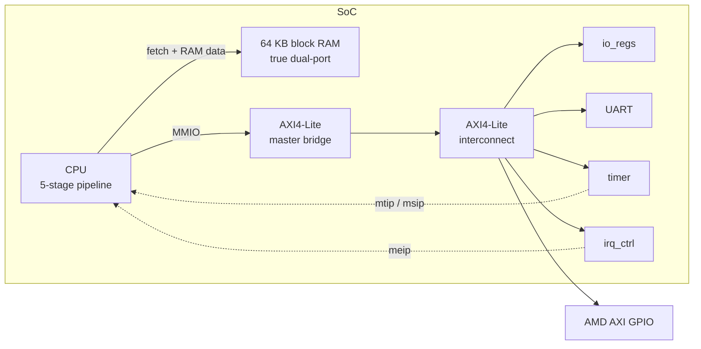

# RS32VI-SoC

A 5-stage pipelined RISC-V (RV32I + Zicsr) CPU and SoC in SystemVerilog, running
on an Alchitry Au v2 (Artix-7 XC7A35T) with the Alchitry Io shield.

- RV32I with machine-mode CSRs, precise exceptions and interrupts
- 5-stage pipeline with forwarding, running at 100 MHz
- Peripherals on an AXI4-Lite bus, including AMD's AXI GPIO IP
- Passes the official riscv-tests (rv32ui, rv32mi)
- Runs bare-metal C: UART terminal, stopwatch on timer and button interrupts

## Architecture



### CPU

Classic IF / ID / EX / MEM / WB pipeline.

- **Forwarding** from MEM and WB into EX, plus a WB-to-ID bypass through the register file.
- **Hazards:** 1-cycle stall for load-use; branches and jumps resolve in EX with a 1-cycle penalty.
- **Precise traps:** EX is the commit point. An instruction either commits there or traps, and everything younger is flushed.
- **CSRs:** `mstatus`, `mie`, `mip`, `mtvec` (direct and vectored), `mepc`, `mcause`, `mtval`, `mscratch`, 64-bit `mcycle` / `minstret`, and the read-only counters and ID registers.
- **Exceptions:** illegal instruction, `ecall`, `ebreak`, misaligned fetch / load / store (with `mtval`).
- **Interrupts:** machine timer, software and external.
- **`fence.i`** refetches, so self-modifying code works.

Measured CPI is 1.06 to 1.24 depending on the program.

### Memory

One 64 KB true dual-port block RAM holds code, data and stack: port A fetches
instructions, port B serves loads and stores. It is written to match Vivado's
byte-write-enable template, so it maps to 16 RAMB36 tiles. Block RAM reads are
synchronous, so the fetch stage addresses it with the *next* PC.

### Bus

Loads and stores outside RAM go over AXI4-Lite. They leave the CPU from the
MEM-stage pipeline registers, and the pipeline stalls until the response. The
interconnect decodes addresses to five slaves plus a default slave. Each of the
four in-house peripherals sits behind a generic AXI4-Lite slave adapter. The
fifth slot is an external port, which on the board connects AMD's `axi_gpio` IP.

## Memory map

| Address | Device |
|---|---|
| `0x0000_0000` | RAM, 64 KB |
| `0x1000_0000` | `tohost`, ends a simulation (unused on the board) |
| `0x2000_0000` | io_regs: LEDs, 7-segment display, DIP switches, buttons, clock rate, cycle counter |
| `0x2000_1000` | UART (115200 baud) |
| `0x2000_2000` | timer: `mtime`, `mtimecmp`, `msip` |
| `0x2000_3000` | interrupt controller: UART RX / TX, 5 buttons |
| `0x2000_4000` | AMD AXI GPIO: 8 outputs (Au LEDs), 24 inputs (DIP switches) |
| other | default slave: reads 0, writes ignored |

C definitions for every register are in [`sw/include/rs32vi.h`](sw/include/rs32vi.h).

## Verification

`sw/run_all.sh` builds everything and runs the full regression in Icarus Verilog:

```
M2 smoke test (hand-written)       PASS
M2 riscv-tests rv32ui              PASS (41 / 41 passed)
M5 riscv-tests rv32mi              PASS (14 / 14 passed)
C c_test (-O0 -O2 -Os)             PASS
C trap_test (-O0 -O2 -Os)          PASS
C pipeline_test (-O0 -O2 -Os)      PASS
M4 SoC demo (soc_tb)               PASS
M5 stopwatch (soc_m5_tb)           PASS
M7 AXI slave adapter (unit)        PASS
M7 AMD GPIO demo (soc_m7_tb)       PASS
```

- **riscv-tests** run with the official `env/p` environment. Three tests are skipped:
  - `ma_data`: this core traps on misaligned accesses, which the spec allows.
  - `breakpoint`: needs debug triggers, which this core doesn't have.
  - `pmpaddr`: needs PMP, which this core doesn't have.
- **C tests** are compiled at three optimisation levels. They cover pipeline hazards, CSRs, traps, `fence.i`, and interrupts arriving at every point in an instruction sequence.
- **SoC testbenches** run the board demos unchanged. The testbench acts as the user: it drives the buttons, switches and UART, and checks the LEDs, display and terminal output.
- **AXI4-Lite** is checked by protocol checkers on the bridge and the external port ([`src/sim/axil_checker.sv`](src/sim/axil_checker.sv)). A model of AMD's GPIO ([`src/sim/axi_gpio_model.sv`](src/sim/axi_gpio_model.sv)) delays every handshake by a random 0 to 3 cycles. The slave adapter also has a unit test with 2000 random transactions.
- **Fault injection:** bugs were deliberately inserted into the pipeline and the bus logic (for example, removing a stall, skipping a flush, or breaking the AXI handshake order) to confirm the regression catches them.

## Results

| | |
|---|---|
| Clock | 100 MHz on the board |
| Timing (5-stage, before AXI) | WNS +1.549 ns at 100 MHz, about 118 MHz max |
| Timing (with AXI4-Lite) | TODO |
| Single-cycle version, for comparison | about 50 MHz max |
| CPI | 1.06 to 1.24 |
| LUTs | 2,483 (11.9% of XC7A35T) |
| Flip-flops | 1,754 (4.2%) |
| Block RAM | 16 RAMB36 (32%), all of it the 64 KB RAM |
| LUTRAM | 44 |

## Repository layout

```
src/
  cpu/          pipeline, decoder, ALU, CSRs, register file, load/store unit
  soc/          SoC top level, RAM, peripherals (io_regs, UART, timer, irq_ctrl)
  axi/          AXI4-Lite master bridge, interconnect, slave adapter
  periph/       UART TX/RX, button debouncer, Io shield interface
  board/        board top: clock wizard, reset, AMD GPIO, pins
  sim/          simulation only: AXI protocol checker, AXI GPIO model
  testbench/
sw/
  crt0.S        reset to main(): stack, mtvec, .bss
  link.ld       memory layout
  include/      rs32vi.h: memory map and CSR helpers
  lib/          UART / timer helpers, trap entry and dispatch
  c/            demos and tests
  *.sh          build and run scripts
constraints/    Au v2 + Io pin constraints
scripts/        Tcl to generate the Vivado IP (clock wizard, AXI GPIO)
third_party/    riscv-tests (git submodule)
```

## Getting started

### Requirements

- [Icarus Verilog](https://github.com/steveicarus/iverilog) 12 or newer
- RISC-V GCC (`riscv64-unknown-elf-gcc`). It builds 32-bit code with `-march=rv32i_zicsr`.
- Python 3
- Vivado, for the board build

### Simulation

```bash
git clone --recursive <repo-url>
cd rs32vi
sw/run_all.sh
```

To run a single program:

```bash
sw/run_soc_m5.sh                        # stopwatch on the whole SoC
OPTS=-O0 sw/run_c.sh sw/c/trap_test.c   # one C test at one optimisation level
```

### Board

1. Create a Vivado project for the XC7A35T-2FTG256 and add `src/cpu`, `src/soc`,
   `src/periph`, `src/axi`, `src/board` and `constraints/rs32vi_au.xdc`.
2. In the Tcl console, run `scripts/create_clk_wiz.tcl` and `scripts/create_axi_gpio.tcl`.
3. Build a program and set `MEM_FILE` in `src/board/rs32vi_top.sv` to its path:
   ```bash
   sw/build_c.sh sw/c/stopwatch.c          # -> build/c/stopwatch.hex
   ```
4. Generate the bitstream and program the board.
5. Open a terminal at 115200 baud: `picocom -b 115200 /dev/ttyUSB0`.

The program is stored in block RAM as part of the bitstream, so a new program
means a new bitstream.

## Demos

| Program | What it does |
|---|---|
| `blinky.c` | Counts in binary on the Au LEDs and walks a light along the Io LEDs |
| `io_demo.c` | Prints a greeting over the UART, mirrors the switches to the LEDs and display, echoes keys |
| `stopwatch.c` | Timer-interrupt stopwatch on the display. The buttons start, stop, reset and lap it. Also takes UART commands. |
| `axi_gpio.c` | Reads the switches through both io_regs and AMD's GPIO, checks they agree, and drives the Au LEDs through the GPIO |

## Milestones

| | Added | Shown by |
|---|---|---|
| M2 | Single-cycle RV32I | riscv-tests rv32ui, smoke test |
| M3 | Bare-metal C in simulation | `c_test.c` |
| M4 | SoC on the board: RAM, UART, IO, clock wizard | `io_demo.c` |
| M5 | CSRs, traps, timer and interrupts | rv32mi, `trap_test.c`, `stopwatch.c` |
| M6 | 5-stage pipeline, block RAM | `pipeline_test.c`, timing at 100 MHz |
| M7 | AXI4-Lite bus with AMD AXI GPIO | `axi_gpio.c`, AXI checkers, adapter unit test |

## Limitations and next steps

- No M extension: multiply and divide are done in software (libgcc).
- Misaligned loads and stores trap rather than being emulated.
- AXI error responses (`SLVERR`, `DECERR`) are ignored. They could become access-fault exceptions.
- One AXI transaction at a time; no outstanding requests.
- Machine mode only.
- Programs are loaded with the bitstream. A UART bootloader would allow loading new programs without rebuilding. The hardware already supports it, since code and data share RAM and `fence.i` works.
